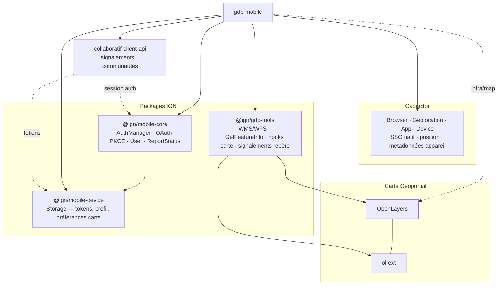
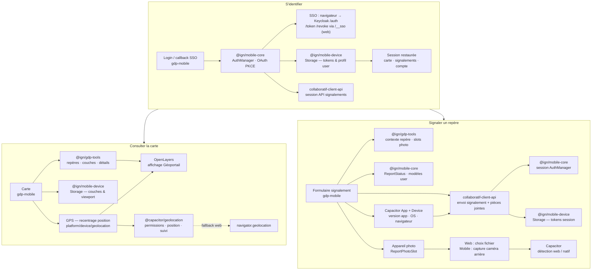

# Architecture — gdp-mobile

## Couches `src/`

```
pages/ + features/ → app/ → infra/ + platform/ → domain/

shared/ + styles/ : utilisables depuis toutes les couches
```

| Couche | Rôle |
|--------|------|
| `domain/` | Modèles purs, sans React ni réseau (imports de **types** `@ign/gdp-tools` acceptés) |
| `infra/` | Auth, API collaboratif, OpenLayers, stockage local, persistance du viewport, cache, analytics Matomo, actualités, thèmes communauté |
| `platform/` | Wrappers `@ign/mobile-device` / Capacitor |
| `app/` | `App.tsx`, router, providers, `BottomTabbar`, `LeftMenu` |
| `features/` | Hooks et composants métier |
| `pages/` | Écrans routés (fine couche) |
| `shared/` | UI, config, constantes, utils |

## Dépendances externes

- `@ign/gdp-tools` : catalogues WMS/WFS, GetFeatureInfo, hooks carte, signalements repère
- `@ign/mobile-core` : `AuthManager`, OAuth PKCE, modèles (`User`, `ReportStatus`)
- `@ign/mobile-device` : persistance locale (`Storage`) — tokens, profil, préférences carte
- `collaboratif-client-api` : signalements et communautés
- `OpenLayers` + `ol-ext` : carte Géoportail
- `Capacitor` : SSO natif, géolocalisation, métadonnées appareil



## Flux utilisateur



| Flux | `@ign/mobile-core` | `@ign/mobile-device` | Capacitor |
|------|--------------------|----------------------|-----------|
| **Identification** | `AuthManager`, OAuth PKCE, modèle `User` | Persistance tokens & profil | `Browser` (SSO natif) |
| **GPS / carte** | — | Préférences carte (couches, viewport) | `Geolocation` (+ fallback navigateur) |
| **Signalement + photo** | Session API, `ReportStatus` | Tokens pour l'API | `App` / `Device` (métadonnées) ; caméra via `<input capture>` |

Notes :

- **Identification** : requise pour envoyer un signalement et consulter le compte ; la carte reste consultable sans connexion. Pas de garde de route globale : les pages `/reports` s’adaptent à `useAuth()` (brouillons locaux vs signalements serveur). En **web**, `/token` et `/revoke` passent par `/__sso` (Vite en local, Apache `ProxyPass` en qualif) pour rester same-origin ; la page de login Keycloak n’est pas proxifiée. En **natif**, `AuthManager` parle à `VITE_OAUTH_BASE_URL`. Voir [README — Apache qualif](../README.md#apache-sur-le-serveur-de-qualif) et [Dépannage](./DEPANNAGE.md).
- **GPS** : bouton de recentrage sur la carte ; wrapper dans `platform/device/` — pas de logique GPS dans `@ign/mobile-core`.
- **Appareil photo** : pas de plugin Capacitor Camera dédié ; en natif, `<input type="file" accept="image/*" capture="environment">` ouvre la caméra ou la galerie. Vérification de l'orientation paysage côté app avant envoi.

## Routes

| Route | Écran |
|-------|-------|
| `/` | Redirect → `/welcome` (premier lancement), sinon `/login` ou `/map` selon `VITE_AUTH_REQUIRED` |
| `/welcome` | Onboarding |
| `/login`, `/auth/callback` | SSO |
| `/map` | Carte — fiche point au clic ([détail](./FICHE_POINT.md)) ; panneaux couches / filtres / légende ([détail](#panneaux-carte)) ; wizard de signalement en overlay |
| `/map/search`, `/map/search/rgp` | Recherche d’adresse et stations RGP (`pages/search/`) — routes enfants de `/map`, affichées par-dessus la carte qui reste montée (`<Outlet>` + `useMapOutletContext`) |
| `/reports` | Mes signalements (brouillons locaux + envoyés si connecté) |
| `/reports/:id` | Détail d’un brouillon / signalement |
| `/reports/history`, `/reports/history/:id` | Historique communauté |

Compte, paramètres, communauté, aide, à propos et déconnexion sont des **overlays** (`SlideUpPage`) ouverts depuis le menu latéral, pas des routes du router (liste : `app/components/LeftMenu/leftMenuRoutes.ts`).

## Panneaux carte

Les boutons flottants **Couches**, **Filtres** (mode expert) et **Légende** de `/map` ouvrent un seul panneau à la fois : état `activeMapPanel` (type `MapPanelId`) dans `pages/map/MapPage.tsx`. Un clic sur le bouton du panneau ouvert le referme ; un clic sur la carte ou la tabbar ferme le panneau.

| Panneau | Composant (`features/map/components/`) |
|---------|----------------------------------------|
| Couches | `MapLayersPanel` — vignettes groupées « Données » / « Fonds de carte » |
| Filtres | `MapGeodesyFiltersPanel` + `GdpGeodesyFiltersForm` — brouillon appliqué au clic **Appliquer** |
| Légende | `MapLegendPanel` — pictos géodésie, disponibilité RGP, signalements |

Couches et filtres sont orchestrés par `MapLayersPanelFlow` (prop `view` : `'layers'` / `'filters'` / `null`), qui fait le lien avec la visibilité des couches et les filtres WFS de `@ign/gdp-tools`.

Charte commune :

- `MapOverlaySheet` : panneau en portail au-dessus de la carte — titre aligné à gauche (+ pastille optionnelle), `size="large"` (plafond `min(92vh, 43.5rem)`), poignée `draggable`, `footer` optionnel.
- `MapSheetSection` : section titrée, séparée de la suivante par un trait. À réutiliser pour tout nouveau panneau.

La recharge des données RGP se fait depuis la liste des stations (`/map/search/rgp`, hook `useNearestRgpStations`), pas depuis le panneau Couches.

## Documentation métier carte

- [Fiche point](./FICHE_POINT.md) — bottom sheet, snaps, variantes géodésie/nivellement, carrousel, mode debug champs
- [Contrat d’échange des signalements](./CONTRAT_SIGNALEMENTS.md) — payload EspaceCo (appli **4.0.1**)
