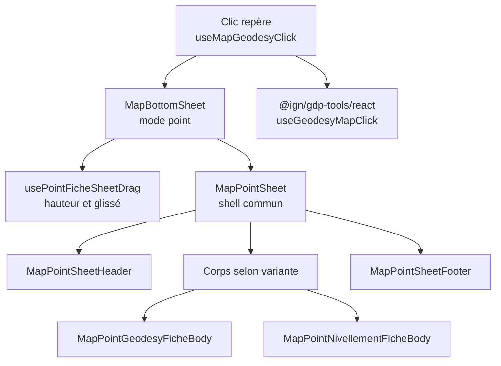

# Fiche point — carte

Documentation de la fiche affichée au clic sur un repère géodésique ou de nivellement sur la carte (`/map`).

## Vue d'ensemble



| Élément | Rôle |
|---------|------|
| `MapBottomSheet` | Bottom sheet carte de la fiche repère (la recherche et les stations RGP sont des routes : `pages/search/`) |
| `usePointFicheSheetDrag` | Hauteur de la fiche : glissé libre, seuil d'ouverture, plein écran, fermeture |
| `MapPointSheet` | Shell fixe : poignée + en-tête (zone de glissé) + corps scrollable + pied de page |
| `MapPointGeodesyFicheBody` | Contenu géodésie (niveaux 1 et 2) |
| `MapPointNivellementFicheBody` | Contenu nivellement (niveaux 1 et 2) |
| `@ign/gdp-tools` | Données repère : titre, attributs, photos, contexte signalement |

**Chemin des sources :** `src/features/map/components/MapBottomSheet/pointFiche/` (hook de glissé : `src/features/map/hooks/usePointFicheSheetDrag.ts`)

## Ouverture d'une fiche

1. L'utilisateur clique un repère sur la carte.
2. `useMapGeodesyClick` s'appuie sur `useGeodesyMapClick` (`gdp-tools/react`), qui construit l'affichage du point (`buildGeodesyPointDisplay`) et le contexte de signalement ; le hook expose un `MapGeodesyClickAction` (`pendingAction`).
3. `MapPage` passe `mapClick.pendingAction` à `MapBottomSheet` en `selectedPoint`.
4. Le bottom sheet bascule en **mode point** : fiche ouverte à sa hauteur minimale, tabbar masquée (donc pas d'accès à la recherche).

Comportements complémentaires :

- **Clic-bascule** : recliquer sur le repère déjà ouvert referme la fiche.
- **Autre repère** : cliquer un autre repère pendant qu'une fiche est ouverte conserve la hauteur courante.
- **Ouverture programmatique** : `openPointAtCoordinate(coordinate)` ouvre la fiche sans clic réel (ex. depuis un signalement).

## Hauteur et glissé (`usePointFicheSheetDrag`)

La fiche n'a pas de snaps fixes : sa hauteur suit le doigt, puis se cale au relâché selon les seuils ci-dessous (fractions de la hauteur du viewport). Géométrie calculée par `getPointFicheSheetGeometry`, recalculée au resize fenêtre.

| Seuil | Valeur | Rôle |
|-------|--------|------|
| Hauteur minimale | max(20 % vh, en-tête + pied de page mesurés) | Hauteur à l'ouverture ; boutons jamais rognés (`--safe-bottom` inclus) |
| Seuil d'ouverture | Hauteur mesurée pour voir la photo / le croquis en entier (repli : 40 % vh) | Bascule du contenu au niveau 2 |
| Zone tampon | seuil − 5 % vh → seuil + 10 % vh | Un relâché dans cette zone se cale exactement au seuil |
| Plein écran | 100 % vh − max(12 px, safe-area haut) | Au-delà de seuil + 10 % vh, la fiche s'ouvre en grand |

- **Sous la zone tampon** : la fiche reste où elle est relâchée (jamais sous la hauteur minimale).
- **Depuis le plein écran** : un relâché au-dessus de 75 % vh revient en plein écran (hystérésis, évite une fermeture accidentelle).
- **Double tap sur la poignée** : ouverture directe en plein écran.
- **Fermeture** : tirer plus de 64 px sous la hauteur minimale ferme la fiche.
- **Zone de glissé** : poignée + en-tête (`dragZone`). Le corps scrolle normalement.

Le seuil d'ouverture et la hauteur minimale sont mesurés dans le DOM par `MapPointSheet` (`useMeasuredHeight` sur la zone de glissé, le bloc photo et le pied de page) et remontés via `onOpenThresholdChange` / `onFloorHeightChange`.

### Niveaux de contenu

`MapBottomSheet` passe au corps un niveau (prop `snapIndex`) calculé sur la hauteur de repos (jamais pendant un glissé actif, pour ne pas interrompre le geste) :

| Niveau | Condition | Contenu |
|--------|-----------|---------|
| 1 | Hauteur < seuil d'ouverture | Carrousel, identité, description, détails (rognés par la hauteur à l'ouverture) |
| 2 | Hauteur ≥ seuil d'ouverture | + coordonnées, remarques, partenaire |

- **Plein écran** (classe `sheetFullscreen`) : même contenu que le niveau 2 ; la fiche perd ses marges latérales et recouvre la carte et ses FAB.
- **Suivi** : `useTrackSheetView` enregistre la consultation du repère au passage au niveau 2.

## Shell commun (`MapPointSheet`)

### En-tête (`MapPointSheetHeader`)

Toujours visible :

- Titre + picto (`GeodesyPointTitle` de `gdp-tools`) et bouton **copier** le numéro du point (coche de confirmation 1,5 s)
- Badge état (`formatEtatLabel`, vert si « BON ETAT »)
- Méta : année de visite, distance à la position de l'utilisateur (uniquement si le suivi GPS est actif)
- Favori : désactivé pour cette version (code commenté)

### Pied de page (`MapPointSheetFooter`)

Toujours visible :

- **S'y rendre** — ouvre la navigation externe vers le repère (`openExternalNavigation`)
- **Signaler** — ouvre le wizard de signalement en overlay sur la carte (`GeodesyPointReportWizard`)

Si le signalement est indisponible (`reportDisabledReason`), le bouton est désactivé et une icône d'aide ouvre une bulle d'explication :

| Raison | Message |
|--------|---------|
| `auth` | Connexion requise, avec lien « Se connecter » vers `/login` |
| `canevas` | Signalement non disponible pour les points de canevas |

Si la couche n'autorise pas le signalement, le bouton est désactivé sans bulle.

### Corps

Toujours monté, dans une zone scrollable. Variante résolue par `resolvePointFicheVariant`.

## Variantes géodésie / nivellement

`resolvePointFicheVariant(action)` retourne `'geodesy'` ou `'nivellement'` :

| Critère | Variante |
|---------|----------|
| Domaine `nivf`, `nivo`, `nive` | nivellement |
| Domaine `rsgf`, `rsgo`, `rsge` | géodésie |
| `layerId === 'RN'` ou `'DOMAIN_NIVELLEMENT'` | nivellement |
| Défaut | géodésie |

### Contenu par niveau

**Géodésie — niveau 1** :

- Carrousel photo / croquis + date d'observation en légende
- **Point géodésique** : numéro du point, ID croquis
- **Description** : badge exploitabilité GPS (`expl_gps` / `expl_gpscode`, voir `gpsExploitabilityBadge.ts`), localisation, type
- **Détails** : département (`entite_no` ou déduit du n° Insee), n° Insee, commune, type du site, localisation

**Géodésie — niveau 2** : coordonnées, remarques, partenaire.

**Nivellement — niveau 1** :

- Carrousel + date d'observation en légende
- **Repère de nivellement** : système d'altitude, altitude (libellé issu de `cp1_altitude_type`), complément, type
- **Détails** : voie suivie, distance au repère voisin, côté, support, localisation, partie support, repèrements

**Nivellement — niveau 2** : coordonnées, partenaire, puis remarques.

**Commun aux deux variantes** :

- **Coordonnées** (`PointCoordinatesSection`, données `pointFicheCoordinates.ts`) : onglets **Géographique** (champs `cg1_*`) et **Projection** (champs `cp1_*`) ; onglet désactivé s'il est vide.
- **Partenaire** (`PartenaireSection`) : nom (`proprio`) et logo chargé via `usePartnerLogo(proprio_id)`.
- **Fiche PDF** (`MapPointPdfSection`) : lien « Télécharger la fiche PDF » (`url_pdf`), affiché à tous les niveaux en bas du corps.

## Carrousel photos / croquis

`PointImageCarousel` + `PointImageLightbox`.

- **Source unique** : `action.point.photos` (`collectGeodesyPointPhotos` dans `gdp-tools`), dédoublonnage par URL (`buildPointCarouselItems`).
- **Navigation** : balayage horizontal (`scroll-snap`), indicateurs points.
- **Sans image** : message « Aucune photo ou croquis disponible. »
- **Plein écran** : bouton en haut à droite de chaque image → lightbox portail (`z-index: 200`), navigation ‹ › et clavier (flèches, Échap).
- **Zoom** (`useLightboxImageZoom`) : pincement et double tap (jusqu'à ×4), déplacement de l'image zoomée ; la navigation entre images est désactivée tant que l'image est zoomée.

Les onglets de contenu (coordonnées) se changent par **clic**, pas par swipe. Seules les images utilisent le swipe horizontal.

## Mode debug — champs non affichés

Section `UnmappedFieldsDebug` en bas du corps, repliée par défaut (chevron pour la déplier).

Objectif : lister les propriétés WFS / attributs pas encore mappés dans la fiche, pour ne rien oublier lors de l'implémentation Figma.

| Fichier | Rôle |
|---------|------|
| `collectAllPointFields` | Agrège propriétés scalaires + attributs + commentaire |
| `displayedFieldKeys.ts` | Clés considérées comme « affichées » par zone (en-tête, niveau 1, niveau 2) |
| `getDisplayedFieldIds` | Union des clés selon variante + niveau |
| `filterUnmappedPointFields` | Différence = liste debug |

**Pour marquer un champ comme couvert** : ajouter sa clé dans `displayedFieldKeys.ts` (et l'afficher dans le corps correspondant).

## Interaction avec le chrome carte (`MapPage`)

Quand une fiche repère est ouverte (`selectedPoint !== null`) :

| Comportement | Détail |
|--------------|--------|
| Tabbar | Masquée (`onTabbarVisibleChange(false)`) |
| Boutons carte (GPS, légende, couches…) | Restent en bas de l'écran, **sous** la fiche (`z-index` sheet > overlays) ; entièrement masqués par la fiche en plein écran |
| Hors fiche | Sheet replié (hauteur 0), resté monté pour animer l'ouverture |

Variable CSS posée sur la racine (`document.documentElement`) par `MapPage`, lue aussi par les panneaux en portail (`MapOverlaySheet`) :

- `--map-tabbar-height` — `var(--tabbar-height)` (global.css) ou `0px` si tabbar masquée ; les FAB GPS / boussole et l'échelle OL se placent au-dessus (`--map-fab-bottom` dans MapPage.module.css)

## Données et utilitaires

| Utilitaire | Rôle |
|----------|------|
| `readProperty(action, key)` | Lit une propriété WFS (casse `key` / `KEY`) |
| `findEtatLabel` / `findVisitYear` | Champs en-tête depuis propriétés ou attributs |
| `buildPointCarouselItems` | Liste images pour le carrousel |
| `buildPointCoordinatesView` | Champs des onglets coordonnées (`pointFicheCoordinates.ts`) |
| `resolveGpsExploitabilityVariant` | Variante visuelle du badge GPS |
| `pointFicheUtils.ts` | Helpers partagés entre les deux corps (formatage, libellés) |

Type principal : `MapGeodesyClickAction` (`useMapGeodesyClick`) — contient `point` (affichage) et `reportContext` (signalement).

## Extension — checklist

1. **Nouveau champ affiché** : lire via `readProperty` ou `action.point.attributes`, l'ajouter au JSX du corps, puis sa clé dans `displayedFieldKeys.ts`.
2. **Nouvelle section** : condition `snapIndex >= 1` (niveau 1) ou `snapIndex >= 2` (niveau 2) dans le corps concerné, clés associées dans `getDisplayedFieldIds`.
3. **Nouvelle variante** : étendre `PointFicheVariant`, `resolvePointFicheVariant`, créer un `MapPoint…FicheBody`.
4. **Section influant sur le seuil d'ouverture** : seul le bloc carrousel est mesuré (`onPhotoBlockHeightChange`) ; ne pas y inclure de contenu secondaire.

## Fichiers principaux

```
features/map/hooks/
└── usePointFicheSheetDrag.ts      # Géométrie + glissé de la fiche

features/map/components/MapBottomSheet/
├── MapBottomSheet.tsx             # Orchestration sheet + niveau de contenu
└── pointFiche/
    ├── MapPointSheet.tsx          # Shell + mesures DOM
    ├── MapPointSheetHeader.tsx
    ├── MapPointSheetFooter.tsx
    ├── MapPointGeodesyFicheBody.tsx
    ├── MapPointNivellementFicheBody.tsx
    ├── PointCoordinatesSection.tsx
    ├── pointFicheCoordinates.ts
    ├── PartenaireSection.tsx
    ├── MapPointPdfSection.tsx
    ├── PointImageCarousel.tsx
    ├── PointImageLightbox.tsx
    ├── useLightboxImageZoom.ts
    ├── useMeasuredHeight.ts
    ├── gpsExploitabilityBadge.ts
    ├── UnmappedFieldsDebug.tsx
    ├── resolvePointFicheVariant.ts
    ├── displayedFieldKeys.ts
    ├── getDisplayedFieldIds.ts
    └── pointFicheUtils.ts
```

## Voir aussi

- [Architecture](./ARCHITECTURE.md) — couches `src/`, flux carte
- `@ign/gdp-tools` — `buildGeodesyPointDisplay`, `collectGeodesyPointPhotos`, catalogues attributs
- `useMapGeodesyClick` — déclenchement au clic carte
